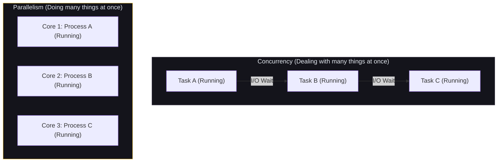

# 🚀 Day 20: Concurrency, Multithreading, Multiprocessing & AsyncIO Architecture

Welcome to **Day 20** of the **30-Day Full Stack Python + AI Engineering Challenge**! 💻🤖

Today marks the grand culmination of **Phase 1 (Python Core & Advanced Systems Architecture)**. Before we step into Phase 2 (Modern Full Stack Web with FastAPI & Databases), mastering how Python handles **concurrency, thread pools, the Global Interpreter Lock (GIL), and non-blocking asynchronous I/O (`asyncio`)** is essential for high-throughput backend APIs and real-time AI token streaming.

---

## 📌 Architecture Roadmap & Module Directory

| Module | Filename | Key Architecture Patterns |
| :--- | :--- | :--- |
| **01** | [`01_gil_concurrency_vs_parallelism_benchmarks.py`](./01_gil_concurrency_vs_parallelism_benchmarks.py) | CPython GIL Internals, CPU vs I/O Workloads, `ProcessPoolExecutor` vs `ThreadPoolExecutor` |
| **02** | [`02_multithreading_threadpools_and_race_conditions.py`](./02_multithreading_threadpools_and_race_conditions.py) | Low-level Threads, Race Conditions, `threading.Lock` / `RLock`, Thread-Safe TTL Cache |
| **03** | [`03_asyncio_event_loop_and_task_groups.py`](./03_asyncio_event_loop_and_task_groups.py) | Event Loop, Coroutines, `asyncio.gather()`, Python 3.11+ `asyncio.TaskGroup`, `asyncio.timeout` |
| **04** | [`04_advanced_async_patterns_and_ai_streaming.py`](./04_advanced_async_patterns_and_ai_streaming.py) | Async Context Managers, LLM Token Streaming (`async for`), `asyncio.Queue`, `asyncio.Semaphore` |
| **Practice**| [`my_practice.py`](./my_practice.py) | 6 Hands-on Engineering Challenges with **100% Automated Unit Test Suite (6/6 Passed)** |

---

## 🧠 Architectural Deep Dive

### 1. Concurrency vs Parallelism & The CPython GIL



- **The CPython GIL (Global Interpreter Lock):** A mutual exclusion lock used by CPython to prevent multiple native OS threads from executing Python bytecodes at the same time. CPython's memory management (`Py_INCREF` and `Py_DECREF` reference counting) is not thread-safe without the GIL.
- **Rule of Thumb:**
  - **CPU-Bound (Number crunching, ML, crypto):** Multithreading **will not speed it up** in Python due to the GIL. Use `multiprocessing` / `ProcessPoolExecutor` to spawn separate OS processes with independent GILs.
  - **I/O-Bound (Web requests, database queries, file streaming):** The CPython GIL is **released** during system calls and I/O wait (`time.sleep()`, socket recv, disk read). Use `asyncio` or `ThreadPoolExecutor`.

---

### 2. Architectural Decision Matrix

| Workload Type | Primary Bottleneck | Recommended Tool | Memory Overhead | GIL Behavior |
| :--- | :--- | :--- | :--- | :--- |
| **Heavy Math / Image / ML** | CPU Cores | `multiprocessing` / `ProcessPoolExecutor` | High (Forked RAM per process) | **Bypassed** (True Parallel across cores) |
| **File I/O / Legacy DB Drivers** | Disk / Network Driver | `ThreadPoolExecutor` | Medium (~8MB stack per thread) | **Released** during I/O operations |
| **10,000+ Concurrent Web Requests** | Network Socket I/O | `asyncio` (Single-Threaded Reactor) | Ultra-Low (Few bytes per coroutine) | Single thread; cooperative `await` points |
| **FastAPI Backend & AI Agents** | Microservice & LLM APIs | `async / await` + `asyncio.TaskGroup` | Minimal | Non-blocking Event Loop |

---

### 3. The Race Condition Demon & Thread Synchronization

When multiple threads mutate shared memory without locking, the sequence of bytecode instructions (`LOAD_FAST`, `BINARY_OP`, `STORE_FAST`) is interrupted by OS preemptive context switching:

```python
# ❌ UNSAFE: Lost Updates / Data Corruption
class UnsafeVault:
    def deposit(self, amount: int):
        current = self.balance
        # OS context switches here! Another thread overwrites balance
        self.balance = current + amount

# ✅ SAFE: Atomic Critical Section via threading.Lock
class SafeVault:
    def __init__(self):
        self._lock = threading.Lock()

    def deposit(self, amount: int):
        with self._lock:  # Guaranteed mutual exclusion
            self.balance += amount
```

---

### 4. Modern AsyncIO & Python 3.11+ Structured Concurrency

In legacy Python, `asyncio.gather()` was common, but if one task failed, other tasks could remain running as orphaned "zombie" tasks in the background. 

Python 3.11 introduced **Structured Concurrency** via `asyncio.TaskGroup`:

```python
# Python 3.11+ Safe Structured Concurrency
async with asyncio.TaskGroup() as tg:
    task1 = tg.create_task(fetch_track("TRK-01"))
    task2 = tg.create_task(fetch_track("TRK-02"))
# When block exits, all tasks are guaranteed complete!
# If one fails, remaining tasks are automatically cancelled and ExceptionGroup is raised.
```

---

### 5. LLM Token Streaming with Async Generators (`async for`)

In modern AI engineering (OpenAI, Anthropic, Gemini APIs), LLMs stream tokens incrementally to avoid waiting 10+ seconds for a complete response. This is built on **Python Asynchronous Generators**:

```python
async def stream_ai_tokens(prompt: str) -> AsyncGenerator[str, None]:
    for token in response_chunks:
        await asyncio.sleep(0.05)  # Simulated token generation
        yield token

# Consuming the stream in real-time
async for token in stream_ai_tokens("Write affirmation"):
    sys.stdout.write(token)
    sys.stdout.flush()
```

---

### 6. Concurrency Throttling with `asyncio.Semaphore`

To prevent hitting **HTTP 429 (Too Many Requests)** on third-party AI APIs or database connection limits, `asyncio.Semaphore` provides non-blocking rate limiting:

```python
semaphore = asyncio.Semaphore(max_concurrent=5)

async def safe_ai_query(prompt: str):
    async with semaphore:  # At most 5 concurrent calls
        return await llm_client.generate(prompt)
```

---

## 🧪 Automated Verification Suite

All 6 hands-on challenges in [`my_practice.py`](./my_practice.py) are verified with automated unit tests:

```bash
$ python my_practice.py
======================================================================
🧪 RUNNING DAY 20 AUTOMATED PRACTICE TEST SUITE
======================================================================
▶ Testing Challenge 1: Thread-Safe Metrics Collector...
  ✓ Challenge 1 Passed! Zero race conditions across 50 concurrent threads.
▶ Testing Challenge 2: Parallel Asset Downloader...
  ✓ Challenge 2 Passed! Parallel execution finished in 0.103s (<0.30s).
▶ Testing Challenge 3: Async Batch Metadata Fetcher...
  ✓ Challenge 3 Passed! 10 async tasks finished in 0.045s (<0.15s).
▶ Testing Challenge 4: Modern TaskGroup with Error Shielding...
  ✓ Challenge 4 Passed! TaskGroup isolated failures and captured all errors cleanly.
▶ Testing Challenge 5: Async Token Stream Accumulator...
  ✓ Challenge 5 Passed! Streamed 6 tokens seamlessly via async for.
▶ Testing Challenge 6: Concurrency Throttling with Semaphore...
  ✓ Challenge 6 Passed! Peak concurrency never exceeded 3 (peak: 3).
======================================================================
🎉 ALL 6/6 PRACTICE CHALLENGES PASSED WITH ZERO ERRORS!
======================================================================
```

---

## 🏆 Key Takeaways & Interview Checklist

1. **Why does multithreading not speed up CPU-bound tasks in Python?**
   - The CPython Global Interpreter Lock (GIL) enforces single-thread execution of Python bytecode. Use `multiprocessing` for CPU-bound tasks.
2. **When should you use `ThreadPoolExecutor` vs `asyncio`?**
   - Use `ThreadPoolExecutor` when dealing with blocking legacy libraries (e.g. standard file I/O, older DB drivers). Use `asyncio` for high-concurrency network sockets, web servers (FastAPI), and webhooks.
3. **What is the difference between preemptive multithreading and cooperative multitasking?**
   - Preemptive: The OS scheduler switches threads arbitrarily, requiring locks to prevent race conditions.
   - Cooperative: The event loop switches execution only at explicit `await` suspension points.
4. **How does Python 3.11+ `asyncio.TaskGroup` prevent memory and task leaks?**
   - It enforces structured concurrency: if one task fails, sibling tasks are cancelled automatically, and all errors are wrapped in an `ExceptionGroup`.
