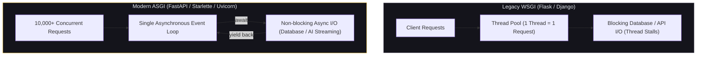
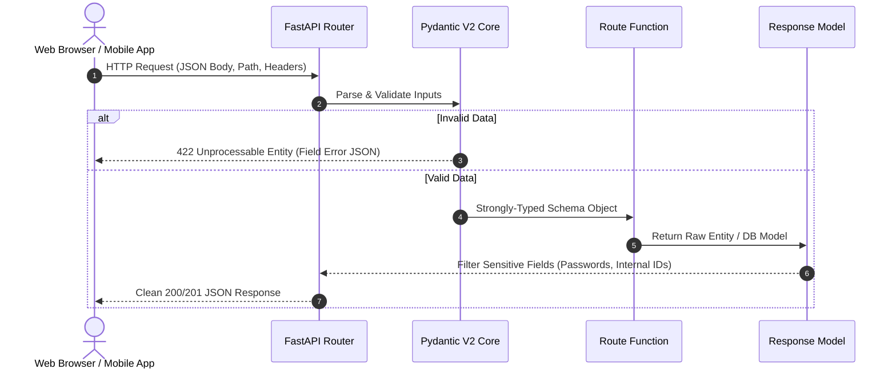

# 🚀 Day 21: FastAPI Architecture, ASGI, Modern REST APIs & Dependency Injection

Welcome to **Day 21** of the **30-Day Full Stack Python + AI Engineering Challenge**! 💻🤖

Today marks the grand official kickoff of **Phase 2: Modern Full Stack Web Development**! Having mastered Python fundamentals, advanced OOP, type systems, and async concurrency in Phase 1 (Days 1–20), we now transition into building high-throughput, enterprise-ready asynchronous web APIs with **FastAPI**, **Starlette (ASGI)**, **Pydantic V2**, and **Uvicorn**.

---

## 📌 Architecture Roadmap & Module Directory

| Module | Filename | Key Architecture Patterns |
| :--- | :--- | :--- |
| **01** | [`01_asgi_architecture_and_fastapi_lifecycle.py`](./01_asgi_architecture_and_fastapi_lifecycle.py) | ASGI vs WSGI, Event Loop Processing, Modern `@asynccontextmanager` Lifespan, CORS & Process Time Middleware |
| **02** | [`02_request_response_lifecycle_and_pydantic_v2.py`](./02_request_response_lifecycle_and_pydantic_v2.py) | Path/Query Parameters, `Field` Validators, Strict `response_model` Sanitization, 422 Automatic Validation |
| **03** | [`03_modular_apirouter_and_clean_architecture.py`](./03_modular_apirouter_and_clean_architecture.py) | Enterprise `APIRouter` Composition, `/api/v1` Prefixing, OpenAPI Tags, Modular Mindifestation Backend |
| **04** | [`04_dependency_injection_system.py`](./04_dependency_injection_system.py) | Inversion of Control with `Depends`, Dependencies with `yield`, Multi-Tier Auth Chaining, `dependency_overrides` |
| **Practice**| [`my_practice.py`](./my_practice.py) | 6 Hands-on Engineering Challenges with **100% Automated Unit Test Suite (6/6 Passed)** |

---

## 🧠 Architectural Deep Dive

### 1. ASGI vs WSGI Architecture



- **WSGI (Web Server Gateway Interface):** Synchronous request-response model. Each connection ties up an OS thread. High concurrent traffic leads to thread exhaustion and massive memory overhead (~8MB per thread).
- **ASGI (Asynchronous Server Gateway Interface):** Single-threaded reactor pattern powered by Python’s `asyncio` event loop. Coroutines yield control during I/O wait (`await`), allowing a single Uvicorn worker to handle tens of thousands of concurrent connections.

---

### 2. Request-Response Lifecycle & Data Sanitization



- **Path Parameters (`Path(...)`):** Coerced to specified Python types automatically (e.g. `/tracks/{track_id: int}`). Strings or floats automatically trigger HTTP 422.
- **Query Parameters (`Query(...)`):** Supports default values, pagination (`limit`, `offset`), and validation rules (`ge`, `le`).
- **Response Models (`response_model=...`):** Ensures internal attributes (like raw passwords, admin notes, or internal database metadata) are **never leaked** to client responses.

---

### 3. Modular APIRouter Composition

Instead of monolithic single-file applications, enterprise backends are structured with domain-driven `APIRouter` instances:

```python
from fastapi import FastAPI, APIRouter

app = FastAPI(title="Mindifestation Sanctuary")

# Domain Routers
auth_router = APIRouter(prefix="/auth", tags=["Authentication"])
sanctuary_router = APIRouter(prefix="/sanctuary", tags=["Meditation Sanctuary"])
payments_router = APIRouter(prefix="/payments", tags=["UPI Checkout Engine"])

# Root /api/v1 aggregation
v1_router = APIRouter(prefix="/api/v1")
v1_router.include_router(auth_router)
v1_router.include_router(sanctuary_router)
v1_router.include_router(payments_router)

app.include_router(v1_router)
```

---

### 4. The Dependency Injection Engine (`fastapi.Depends`)

FastAPI’s Dependency Injection system provides **Inversion of Control (IoC)**, enabling modular authentication, database session management, and painless test mocking:

```python
# 1. Resource Lifecycle with yield
def get_db():
    session = SessionLocal()
    try:
        yield session  # Passed to route handler
    finally:
        session.close()  # Guaranteed cleanup even if error occurs!

# 2. Multi-Tier Dependency Chaining
async def get_current_user(token: str = Depends(oauth2_scheme), db: Session = Depends(get_db)):
    return authenticate_user(token, db)

async def require_admin(user: User = Depends(get_current_user)):
    if user.role != "admin":
        raise HTTPException(status_code=403, detail="Forbidden")
    return user
```

---

## 🧪 Automated Verification Suite (6/6 Passed)

All 6 hands-on challenges in [`my_practice.py`](./my_practice.py) are verified with automated unit tests via `fastapi.testclient.TestClient`:

```bash
$ python my_practice.py
======================================================================
🧪 RUNNING DAY 21 AUTOMATED FASTAPI PRACTICE TEST SUITE
======================================================================
▶ Testing Challenge 1: Path & Query Parameter Validation...
  ✓ Challenge 1 Passed! Path coercion and query boundary validation verified.
▶ Testing Challenge 2: Pydantic V2 Request & Response Sanitization...
  ✓ Challenge 2 Passed! Pydantic V2 response model sanitized sensitive credentials.
▶ Testing Challenge 3: Custom Exception Handler (RFC 7807)...
  ✓ Challenge 3 Passed! Custom exception transformed into RFC 7807 problem details.
▶ Testing Challenge 4: Modular APIRouter Composition...
  ✓ Challenge 4 Passed! APIRouters modularly composed under /api/v1 namespace.
▶ Testing Challenge 5: Dependency with Yield Lifecycle...
  ✓ Challenge 5 Passed! Yield dependency guaranteed automatic cleanup and commit.
▶ Testing Challenge 6: API Key Security & Dependency Overrides...
  ✓ Challenge 6 Passed! Security enforced and dependency_overrides demonstrated.
======================================================================
🎉 ALL 6/6 FASTAPI PRACTICE CHALLENGES PASSED WITH ZERO ERRORS!
======================================================================
```

---

## 🏆 Key Takeaways & Interview Checklist

1. **Why does FastAPI outperform Flask and Django REST Framework in concurrency?**
   - FastAPI is built on Starlette and ASGI, running on Uvicorn's event loop. Instead of blocking worker threads during I/O waits, it yields execution to handle other incoming requests concurrently.
2. **What is the difference between `response_model` and return type annotation?**
   - Return type annotations provide editor type hints, while `response_model` instructs FastAPI to validate, serialize, filter, and document the outgoing payload in OpenAPI.
3. **How does `Depends` with `yield` prevent database connection leaks?**
   - The code after `yield` runs in a `finally` block, guaranteeing that sessions are closed or rolled back even if an unhandled exception is raised in the route handler.
4. **How do you mock authentication or databases in FastAPI unit tests?**
   - By setting `app.dependency_overrides[dependency_function] = mock_function`, tests can bypass production headers or live databases cleanly.
